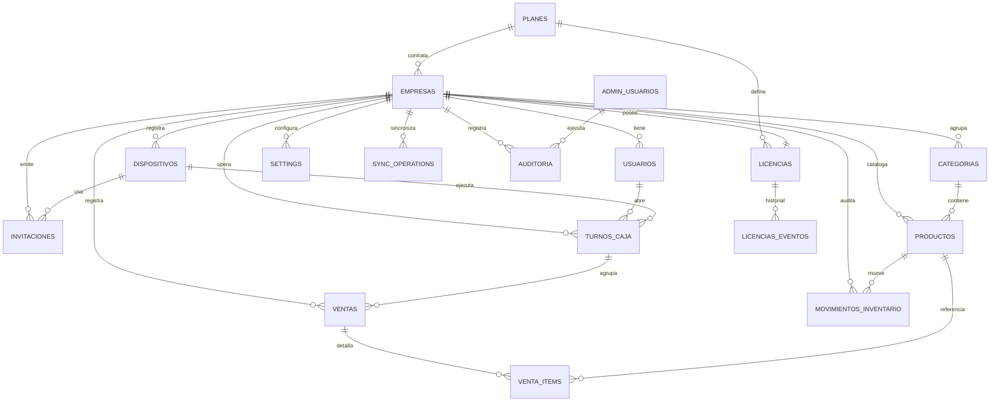

# Modelo de datos — MiCaja multiempresa

> Fase 2. Implementación PostgreSQL en `apps/backend/supabase/migrations/`.

## 1. Diagrama entidad-relación

## 2. Reglas transversales

- **Identificadores:** UUID (`gen_random_uuid()`) en todas las entidades sincronizables.
- **Tenant:** `empresa_id NOT NULL` en toda entidad de negocio.
- **Fechas:** `timestamptz`; el servidor asigna `created_at`, `updated_at` y `fecha_servidor`.
- **Borrado:** catálogo y usuarios usan borrado lógico (`deleted_at`) para sincronizar tombstones.
- **Dinero:** `numeric(14,2)`; nunca `float`.
- **Stock:** `numeric(14,3)`; se modifica solo junto a un registro en `movimientos_inventario`.
- **Aislamiento reforzado:** claves foráneas compuestas `(empresa_id, id)` para impedir referencias cruzadas entre empresas.
- **Idempotencia:** `ventas.local_id`, `sync_operations.operation_id`, `licencias.codigo_activacion_hash` e `invitaciones.codigo_hash` tienen restricciones únicas.

## 3. Tablas globales

### `planes`
| Campo | Tipo | Notas |
|---|---|---|
| id | uuid PK | |
| codigo | text UNIQUE | `basico`, `pro`, `empresa` |
| nombre | text | |
| max_dispositivos | integer | `NULL` = sin límite |
| features | jsonb | lista de funcionalidades |
| precio_mensual | numeric(12,2) | informativo |
| activo | boolean | |
| created_at / updated_at | timestamptz | |

### `admin_usuarios`
Usuarios del panel MiCaja Admin. Email único, `password_hash` bcrypt, rol `superadmin`/`operador`, `activo`.

## 4. Núcleo multiempresa

### `empresas`
`id`, `nombre`, `propietario`, `email`, `telefono`, `estado` (`pendiente|activa|suspendida|cancelada`), `plan_id`, `created_at`, `updated_at`, `deleted_at`.

### `licencias`
Una por empresa (`empresa_id UNIQUE`).

`id`, `empresa_id`, `plan_id`, `estado` (`pendiente|activa|vencida|suspendida`), `activada_en`, `vence_en`, `grace_dias`, `features`, `codigo_activacion_hash`, `codigo_expira_en`, `codigo_usado_en`, `created_at`, `updated_at`.

### `licencias_eventos`
Historial inmutable: `id`, `licencia_id`, `empresa_id`, `tipo` (`creada|activada|renovada|suspendida|reactivada|vencida`), `payload`, `created_at`.

### `dispositivos`
`id`, `empresa_id`, `nombre`, `plataforma`, `app_version`, `fingerprint`, `estado` (`activo|inactivo|bloqueado`), `rol` (`propietario|admin|dependiente`), `licencia_firmada`, `licencia_emitida_en`, `last_seen_at`, `last_sync_at`, `created_at`, `updated_at`. Único `(empresa_id, fingerprint)`.

El rol se fija al activar el dispositivo: el código del negocio concede `propietario` y una invitación concede el rol invitado (`admin` o `dependiente`). El servidor lo lee de esta columna (no del token) para autorizar invitaciones, desvinculaciones y cambios de usuarios. Cualquier rol activo puede sincronizar ventas, movimientos, turnos y settings de su terminal.

El plan limita cuántos dispositivos `activo` puede tener la empresa (`planes.max_dispositivos`). Al llegar al límite, la activación admite `reemplazarA` con el id del dispositivo que se retira; el retirado queda `inactivo` y sin licencia firmada.

El login global reutiliza el dispositivo por `fingerprint`: si ya existe, actualiza `plataforma`, `app_version` y `last_seen_at` sin cambiar su nombre ni reactivar un estado `inactivo`/`bloqueado`. Si la huella es nueva, aplica las mismas reglas de plazas, invitación y reemplazo que la activación por código.

### `invitaciones`
Códigos de un solo uso para que un trabajador una su propio dispositivo al negocio.

`id`, `empresa_id`, `rol` (`admin|dependiente`), `codigo_hash` UNIQUE, `expira_en`, `usado_en`, `dispositivo_id`, `created_at`, `updated_at`.

El código en claro solo se devuelve al crearlo; se guarda su hash. Al activar con una invitación se registra el dispositivo, se marca `usado_en` y ese dispositivo entra con el rol invitado. Las invitaciones no se pueden usar para reemplazar dispositivos existentes (cada plaza nueva la autoriza el propietario).

### `usuarios`
Usuarios locales del negocio. `id`, `empresa_id`, `nombre`, `usuario`, `rol` (`propietario|admin|dependiente`), `password_hash` (hash del PIN para el login global), `activo`, `created_at`, `updated_at`, `deleted_at`.

- `usuario` es único a nivel global entre usuarios vivos: índice `ux_usuarios_usuario_global` sobre `lower(usuario) WHERE deleted_at IS NULL`. La migración `202611160001_usuarios_globales.sql` renombra duplicados históricos agregándoles empresa e id.
- `password_hash` guarda `sha256it$<rondas>$<sal>$<hash>` (o `sha256$…` legado). El PIN en claro no se almacena; el `pull` nunca devuelve este campo.

## 5. Catálogo

### `categorias`
`id`, `empresa_id`, `nombre`, `color`, `orden`, `activo`, `updated_at`, `deleted_at`. Único `(empresa_id, id)`.

### `productos`
`id`, `empresa_id`, `categoria_id`, `nombre`, `precio`, `emoji`, `color`, `imagen` (texto/data URI o URL), `orden`, `activo`, `stock_actual`, `stock_minimo`, `version`, `updated_at`, `deleted_at`.

## 6. Operación

### `turnos_caja`
`id`, `empresa_id`, `dispositivo_id`, `usuario_id`, `apertura`, `cierre`, `estado`, `fondo_inicial`, `total_esperado`, `desglose` jsonb, `dinero_real`, `diferencia`, `created_at`, `updated_at`.

Índice parcial único: un solo turno abierto por `(empresa_id, dispositivo_id)`.

### `ventas`
`id`, `empresa_id`, `dispositivo_id`, `usuario_id`, `turno_id`, `local_id` (UUID generado en el dispositivo), `numero` (asignado por el servidor), `fecha_cliente`, `fecha_servidor`, `subtotal`, `descuento_pct`, `total`, `forma_pago`, `monto_efectivo`, `monto_digital`, `anulada`, `motivo_anulacion`, `anulada_por`, `anulada_en`, `created_at`, `updated_at`.

Únicos: `(empresa_id, numero)` y `(empresa_id, dispositivo_id, local_id)`.

### `venta_items`
`id`, `empresa_id`, `venta_id`, `producto_id`, `nombre`, `precio_unitario`, `cantidad`, `subtotal`.

### `movimientos_inventario`
Libro inmutable: `id`, `empresa_id`, `producto_id`, `tipo` (`inicial|venta|anulacion|entrada|salida|ajuste`), `cantidad`, `referencia_tipo`, `referencia_id`, `usuario_id`, `dispositivo_id`, `created_at`.

## 7. Configuración y sincronización

### `settings`
`empresa_id`, `clave`, `valor` jsonb, `updated_at`. PK `(empresa_id, clave)`.

### `sync_operations`
`id`, `empresa_id`, `dispositivo_id`, `operation_id` UUID, `tipo`, `payload` jsonb, `estado` (`pendiente|aplicada|rechazada|conflicto`), `resultado` jsonb, `error`, `created_at`, `processed_at`. Único `(empresa_id, operation_id)`.

### `auditoria`
`id bigserial`, `empresa_id` (nullable para acciones globales), `actor_tipo`, `actor_id`, `accion`, `entidad`, `entidad_id`, `payload`, `ip`, `created_at`.

## 8. Políticas de conflicto

| Entidad | Regla |
|---|---|
| Ventas | Inmutables. El servidor recalcula totales y rechaza payloads inconsistentes. |
| Anulaciones | Operación compensatoria; nunca se borra la venta original. |
| Inventario | Libro de movimientos; el stock es una caché reconstruible. |
| Catálogo / settings | Versión + `updated_at`; el servidor decide y devuelve el estado ganador. |
| Turnos | Único abierto por empresa/dispositivo; cierre idempotente. |
| Licencia | El servidor emite una nueva licencia firmada; el dispositivo la reemplaza. |

## 9. RLS

Todas las tablas de negocio tienen RLS habilitado y forzado. Políticas:

- **Tenant:** `empresa_id = current_setting('app.tenant_id', true)::uuid`.
- **Admin:** `current_setting('app.admin', true) = 'true'`.
- **Planes:** lectura pública autenticada; escritura solo admin.

El backend ejecuta `SET LOCAL app.tenant_id` o `SET LOCAL app.admin` al inicio de cada transacción. El rol de base de datos de la API debe ser `NOBYPASSRLS` (ver `docs/SUPABASE_SETUP.md`).
